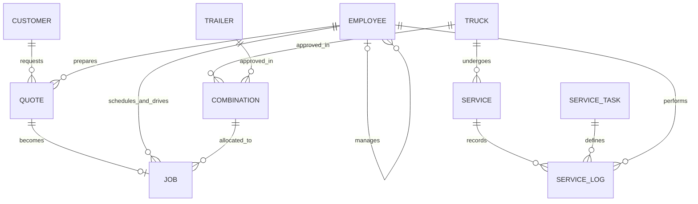

# Current Relational Relationships

This is a newly written relationship summary of the supplied business model and curated implementation, including the portfolio maintenance extension. The original supplied diagram is omitted. It does not imply original authorship of that business model.

`JOB` has separate `sched_emp_no` and `driver_emp_no` foreign keys to `EMPLOYEE`. The diagram combines those two lines for readability. Role codes are `B` manager, `T` dispatcher, `M` mechanic and `D` driver. Driver licences are required only for drivers. Manager-role and job/service-role consistency is audited through joins rather than guaranteed by employee-ID foreign keys.

| Table | Key | Important constraints/meaning |
| --- | --- | --- |
| `CUSTOMER` | `cust_no` | At least one personal/business name; optional name parts. |
| `TRUCK` | `truck_vin` | Separate purchase and odometer facts. |
| `TRAILER` | `trailer_code` | Separate purchase facts. |
| `COMBINATION` | `(truck_vin, trailer_code)` | Approved pairing; both parent foreign keys. |
| `EMPLOYEE` | `emp_no` | Unique contact and licence; role/licence and local reporting checks. |
| `QUOTE` | `quote_no` | Positive original price; preferred date not before preparation. |
| `JOB` | `job_no` | Unique `quote_no`; approved pair; drop-off after pickup; optional positive revised cost; payment Y/N. |
| `SERVICE_TASK` | `task_code` | Unique task name and extensible descriptions. |
| `SERVICE` | `service_id` | Unique `(truck_vin, service_start_datetime)`; optional end; nonnegative odometer. |
| `SERVICE_LOG` | `(service_id, task_code)` | One mechanic and mandatory note per task in a service. |

The quote-status column is materialized and backfilled during migration. A new job-change trigger maintains it. The service surrogate preserves identity while the natural truck/start key prevents duplicate service events. There is no general collision-prevention mechanism for concurrent job scheduling, and maintenance does not automatically advance the truck's stored last-service reading.

[Editable diagram source](../models/current-relationships.mmd) · [core DDL](../sql/02-core-schema.sql) · [integrity overlay](../sql/03-integrity.sql)
