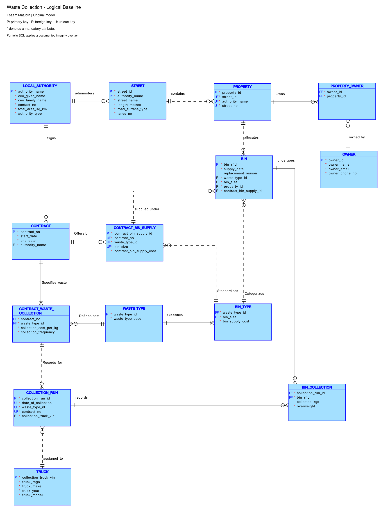

# Waste Collection: Contract Pricing and RFID Collections

A design-led case study for a waste collection service: councils contract for waste types and per-kilogram collection prices, properties receive RFID-tagged bins, and collection runs record either a weight or an overweight rejection.

The work includes 14 related tables, a conceptual model, a logical and relational Data Modeler project, report-based normalisation and generated Oracle DDL. It is an educational demonstration with a newly added synthetic setup path.

## Model and evidence



This is the author's **design baseline**, cleaned of private identifiers. [Current-model notes](design/current-model.md) explain the integrity overlay and show the implemented relationships after cleanup. The baseline includes two redundant bin-type columns removed by that overlay.

- [Conceptual preview](design/conceptual-baseline.png) · [cleaned PDF](design/conceptual-baseline.pdf) · [editable draw.io source](models/conceptual-baseline.drawio)
- [Logical PDF](design/logical-baseline.pdf) · [editable Data Modeler project](models/data-modeler/waste-collection-baseline.dmd)
- [Assumptions and keys](design/assumptions.md) · [UNF through 3NF](design/normalisation.md)
- [Baseline DDL](sql/01-schema.sql) · [integrity overlay](sql/02-integrity.sql)

Keep the complete `models/data-modeler/waste-collection-baseline/` companion directory next to the `.dmd`. Its XML has been parsed and compared with the SQL baseline; reopening the cleaned project in the native Data Modeler application remains unverified.

## Design decisions

Streets are identified within an authority, and properties keep the natural address key alongside a surrogate ID. A property can have several owners through `PROPERTY_OWNER`. Bin supply agreements keep both a surrogate ID and uniqueness of contract/waste type/size. Collection runs similarly retain uniqueness of contract/waste type/day.

Catalogue bin prices, negotiated supply prices and collection prices are separate facts. A bin points to its original supply agreement, so a later contract does not silently change its historical supply charge. Truck VIN is the identity; registration is reusable. The integrated schema derives bin type from the supply agreement.

[Assumptions](design/assumptions.md) distinguish optional onboarding records, operational participation requirements and rules checked only by audit. Cross-table authority/date matching and one property/waste collection per day are not fully enforced against arbitrary concurrent writes.

## Run and inspect

Prerequisites: Oracle 19c+, SQL*Plus or SQLcl, and an empty dedicated `PORTFOLIO_WASTE` user. [Shared setup instructions](../../docs/SETUP.md) list required grants and password-safe connection commands.

```sql
@case-studies/waste-collection/sql/setup.sql
```

Order: environment guard → baseline schema → integrity overlay → synthetic data → runtime assertions → collection reports. The setup does not drop objects. To recreate it, run the case-specific [reset](sql/reset.sql), confirm its prompt, then run setup again.

The examples illustrate a bin supplied under contract 101 for 55 while its catalogue price is 65; it is later collected under contract 102 at 0.18 per kilogram. A separate landfill-bin attempt is overweight and has no collected weight. These values are expected fixture calculations, not newly executed Oracle output.

[Assertions](verification/assertions.sql) cover duplicate natural keys, unsupported contract waste, invalid identifiers/dates, overweight semantics and cross-table assignment audits. [Historical schema output](verification/historical-schema-output.txt) records the supplied baseline run only. See [verification status](../../docs/VERIFICATION.md) for the checks actually executed during preparation.
