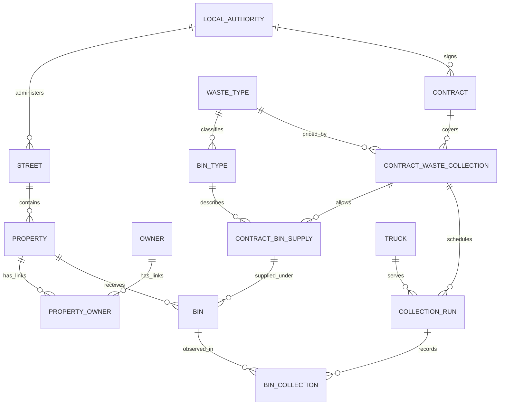

# Current Relational Relationships

This new diagram summarizes relationships after applying `01-schema.sql` and `02-integrity.sql`. It shows what the database permits; operational minimum participation is discussed in [assumptions](assumptions.md). The original cleaned diagrams and Data Modeler project deliberately remain labelled as the **baseline**.

The main delta is `CONTRACT_WASTE_COLLECTION → CONTRACT_BIN_SUPPLY → BIN`. A supply agreement determines the bin type; `BIN` no longer stores a second copy of that type. The generated baseline's direct `CONTRACT → CONTRACT_BIN_SUPPLY` foreign key is retained as a redundant but compatible parent reference. The diagram suppresses that redundant path for readability.

Column names, types, comments and exact keys remain authoritative in [baseline SQL](../sql/01-schema.sql), [overlay SQL](../sql/02-integrity.sql) and the [key inventory](assumptions.md). The overlay reduces `BIN` from seven to five columns. It does not replace the author's model with a newly invented business design.

[Editable diagram source](../models/current-relationships.mmd) · [original logical preview](logical-baseline.png)
